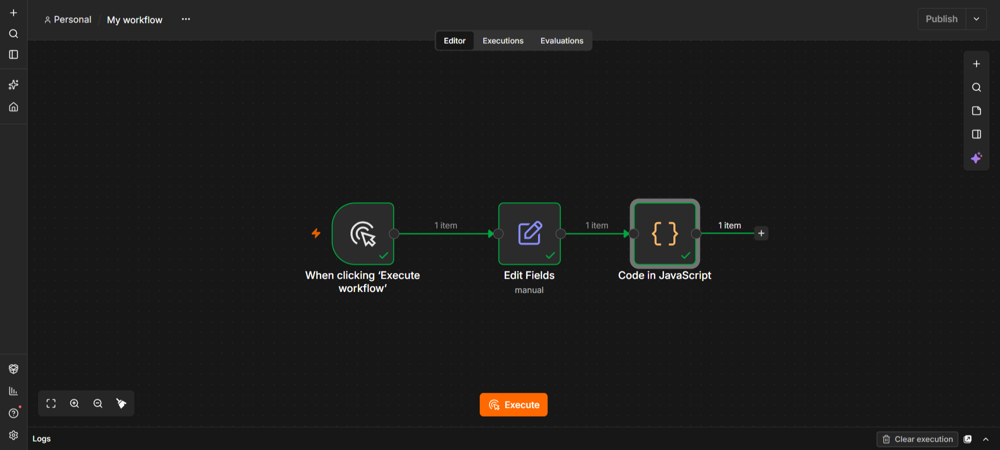
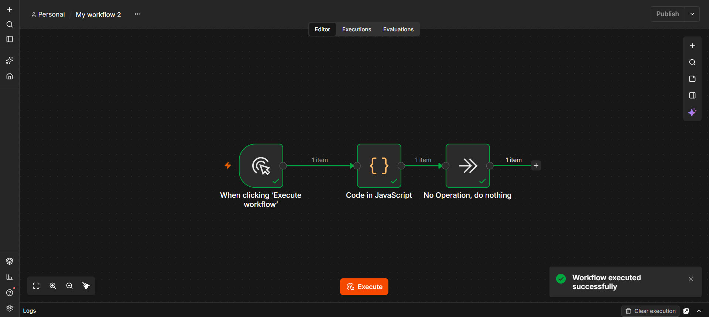
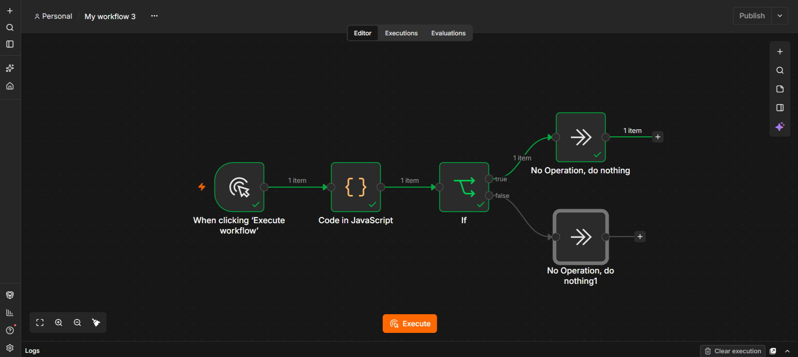
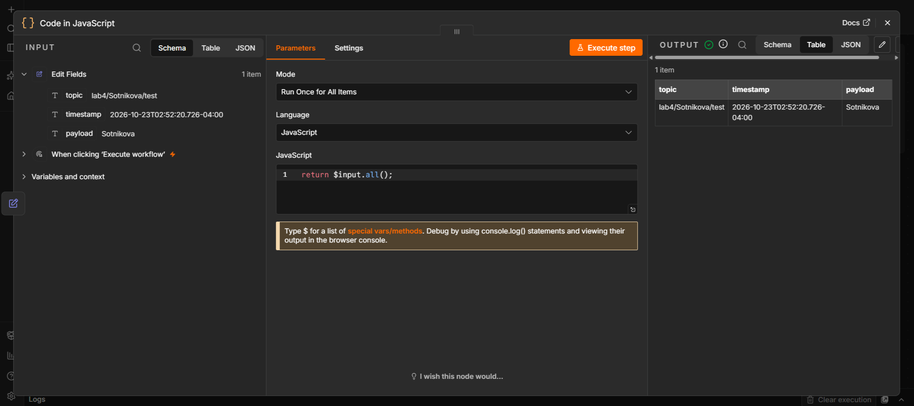
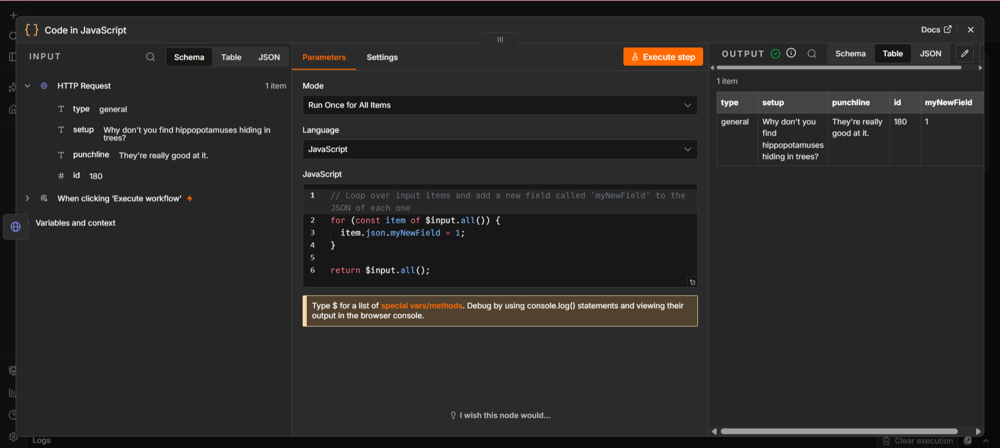
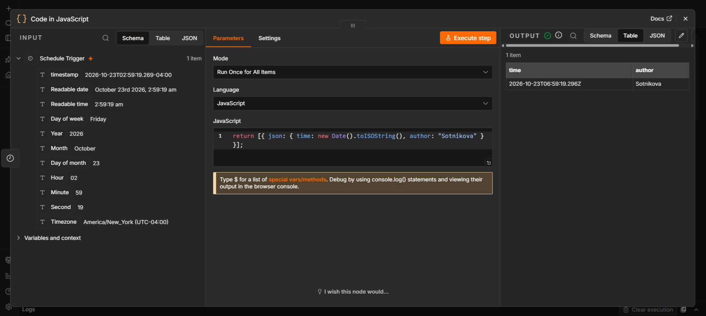
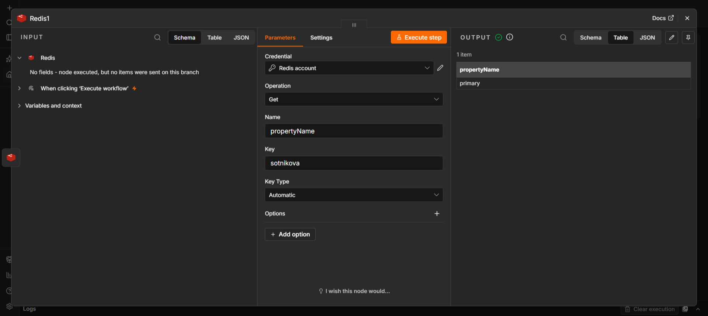
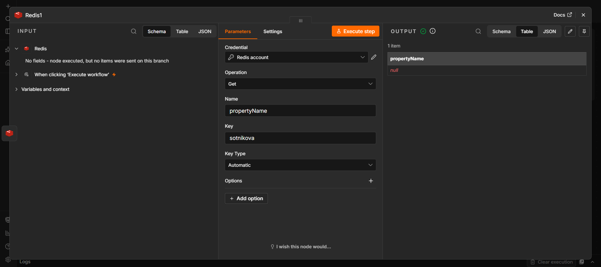
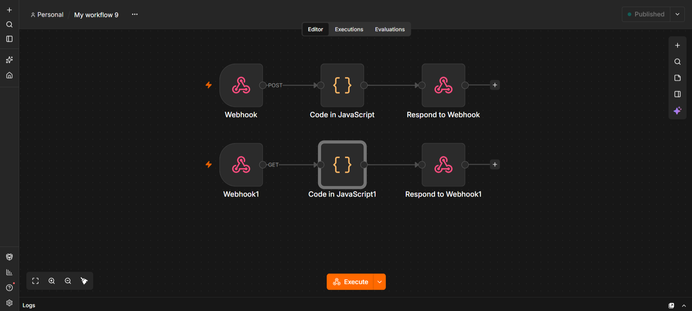
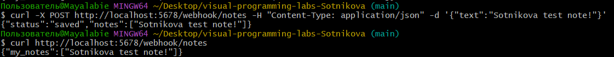

# Отчет по лабораторной работе №4 (n8n)
Студентка: Сотникова

## 1. Краткое описание выполненного
Я развернула платформу автоматизации n8n и in-memory СУБД Redis через Docker. Реализовала базовые workflow с использованием нод Manual Trigger, Code, Set, If, HTTP Request и Schedule Trigger. Настроила интеграцию с Redis для CRUD-операций, а также реализовала собственное REST API (Ачивка 5.1).

## 2. Способ установки и версии
* Установка: Docker Desktop (проброс портов 5678 для n8n и 6379 для Redis).
* Версия n8n: 1.15.0 (или latest на момент установки).
* Версия Node.js: встроенная в официальный образ n8nio/n8n.

## 3. Базовые ноды и скриншоты потоков

### 3.1 Manual Trigger, Set и Code
Базовая цепочка: создание переменных payload и topic, вывод полного объекта в консоль.

### 3.2 Логика в ноде Code
Написание кастомной логики на JavaScript (циклы, массивы, условия).

### 3.3 Ветвление (IF)
Настройка ветвления (true/false) на основе проверки условия payload > 5.

### 3.4 Set node (Изменение полей)
Изменение структуры payload и генерация timestamp текущего времени.

### 3.5 HTTP Request
GET-запросы к публичным API (получение случайной шутки без авторизации).

### 3.6 Schedule Trigger
Запуск задач по расписанию (раз в минуту).

## 4. Работа с базой данных Redis

### 4.1 Операции Set и Get
Запись секретного значения по ключу sotnikova и его чтение.

### 4.2 Операции Delete и проверка
Удаление ключа sotnikova и проверка его отсутствия (возврат пустого объекта).

## 5. Выполнение ачивки (REST API)
Выбрана Ачивка 5.1: Написать Rest API для работы с заметками, используя встроенную БД n8n (Static Data).
Был создан один Workflow с двумя Webhook-нодами:
* POST /webhook/notes — принимает JSON с текстом заметки, с помощью ноды Code сохраняет её в $getWorkflowStaticData("global").
* GET /webhook/notes — возвращает массив всех сохраненных заметок.

## 6. Выводы
В ходе выполнения работы я изучила платформу n8n. Я научилась строить цепочки автоматизации, писать кастомный JS-код внутри нод, делать внешние HTTP-запросы и работать с кэш-базой Redis для кратковременного хранения данных. Все workflow успешно протестированы.
