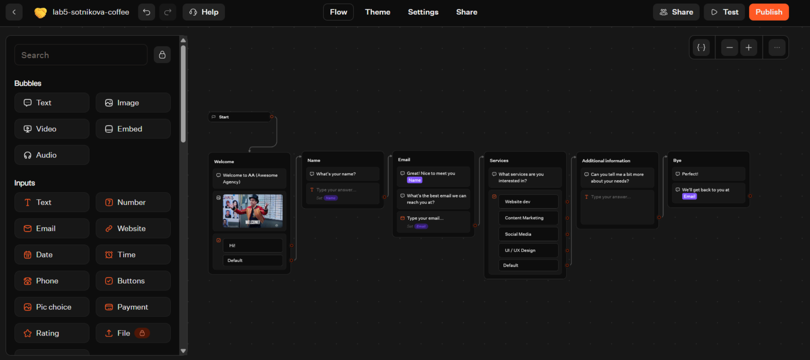
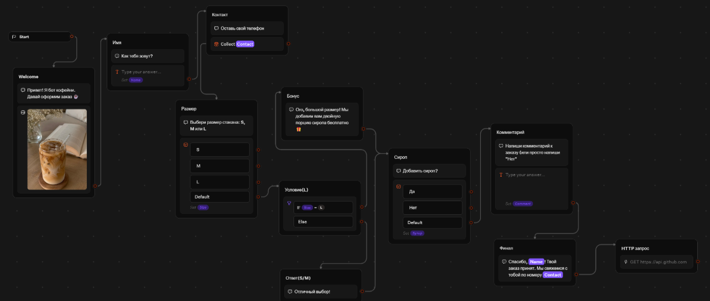
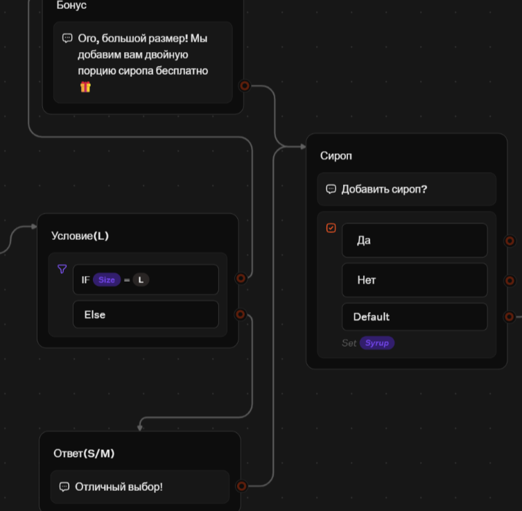
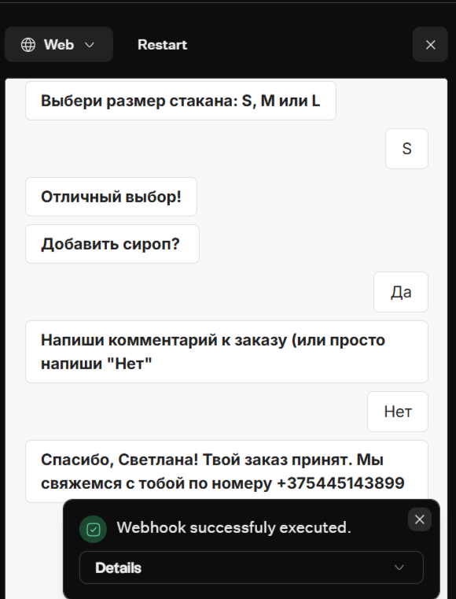
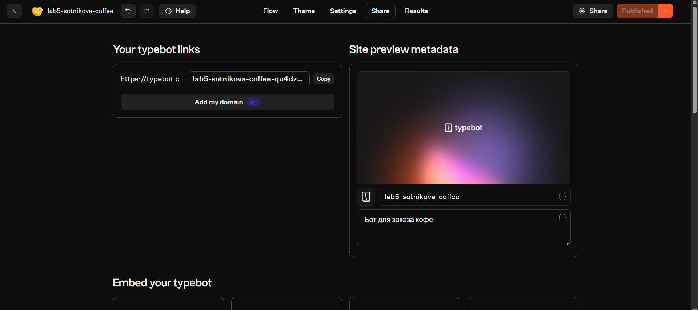
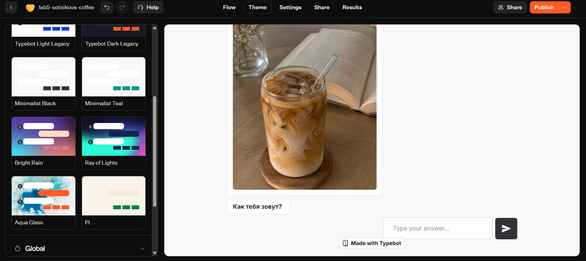

# Лабораторная работа №5. Чат-боты

**Студент:** Сотникова Светлана  
**Группа:** ИИ-241
**Трек:** C — TypeBot  
**Платформа:** TypeBot Cloud

## 1. Краткое описание выбранного трека
В рамках лабораторной работы был выбран трек C (TypeBot). Бот создан на основе готового шаблона Lead Generation и переделан под тематику «Заказ кофе». Бот собирает имя клиента, контактный номер, размер стакана и уточняет, нужен ли сироп. В зависимости от размера (если выбран L) бот предлагает бонус. В конце данные отправляются через HTTP-запрос.

## 2. Ссылка на бота / flow
- **Web-ссылка:** https://typebot.co/lab5-sotnikova-coffee-qu4dz5u
- **Экспорт JSON:** `lab5/exports/flow-01-sotnikova.json`

## 3. Использованные AI-промпты (3–5 примеров)
1. «Как в TypeBot перевести готовый шаблон на русский язык, не сломав переменные?»
2. «Как добавить Condition в TypeBot, чтобы проверить переменную Size?»
3. «Как настроить Webhook в TypeBot и передать в него переменные Name и Contact?»
4. «Помоги придумать красивый текст для превью ссылки и настройки темы для бота-кофейни».

## 4. Освоенные блоки / ноды / элементы
В ходе работы были освоены следующие элементы TypeBot:
- **Текстовые блоки (Text)** — для приветствия и вопросов.
- **Поля ввода (Text Input, Phone)** — для сбора имени и контакта.
- **Переменные (Variables)** — Name, Contact, Size, Syrup, Comment.
- **Условие (Condition)** — проверка `IF Size == L` для выдачи бонуса.
- **Блок кнопок (Buttons)** — для выбора сиропа (Да/Нет).
- **HTTP Request / Webhook** — для отправки данных на сервер.
- **Настройка темы (Theme)** — смена фона и шрифта.
- **Публикация (Publish)** — создание веб-ссылки.

## 5. Скриншоты workflow и диалогов

**Шаблон до перевода (02-template-before.png):**

**Итоговая схема бота (03-template-after.png):**

**Блок условия IF Size == L (04-condition.png):**

**Тестирование бота и успешный Webhook (05-test-chat.png):**

**Публикация и превью ссылки (06-published.png):**

**Смена темы (07-theme.png):**

## 6. Выводы
В ходе выполнения лабораторной работы я освоила платформу TypeBot. Поняла, как работают переменные, как с их помощью передавать данные между блоками и использовать в тексте. Научилась настраивать условия (Condition) и вебхуки. Самым сложным было разобраться с интерфейсом (добавление кнопок), но это компенсируется визуальной логикой. Ограничением бесплатного тарифа является невозможность подключения Telegram, но публикация через веб-ссылку полностью решает задачу.