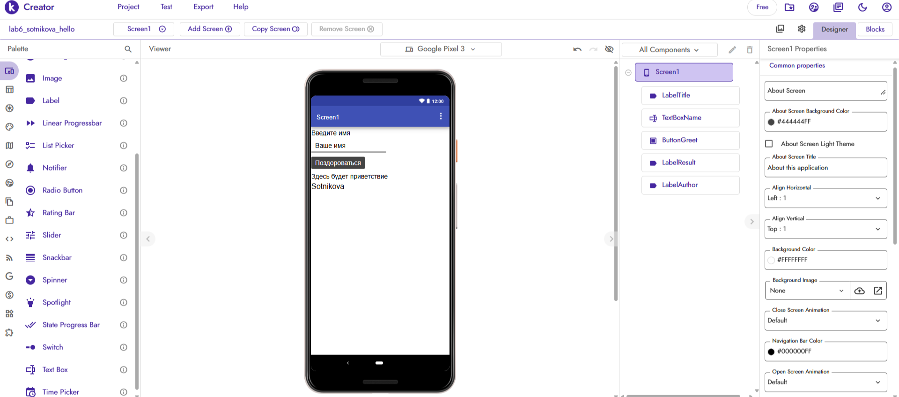
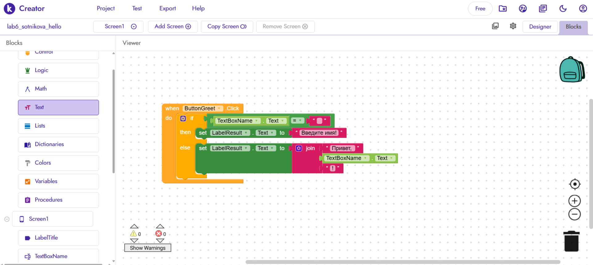
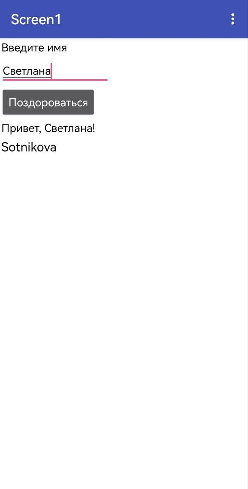

# Лабораторная работа №6. Kodular

**Студент:** Сотникова Светлана  
**Группа:** ИИ-241 
**Проект:** lab6-sotnikova-hello  
**Ссылка на .aia:** `lab6/exports/lab6-sotnikova.aia`

## 1. Краткое описание приложения
В рамках лабораторной работы было создано простое мобильное приложение «Приветствие» на платформе Kodular. На экране Screen1 размещены: заголовок «Введите имя», поле ввода (TextBox) с подсказкой «Ваше имя», кнопка «Поздороваться», Label для вывода результата и Label с фамилией автора «Sotnikova» (обязательное требование). 

Логика реализована с использованием условного блока `if/else` и блока соединения строк `join`: если поле ввода пустое, приложение выводит ошибку «Введите имя!», иначе — приветствие «Привет, <имя>!».

## 2. Ссылка на проект
Проект экспортирован в файл `lab6-sotnikova.aia` (папка `exports/`). Публикация в Kodular Gallery не выполнялась, так как достаточно локального файла `.aia` для проверки.

## 3. Использованные AI-промпты (3–5 примеров)
При выполнении работы использовались следующие запросы к ИИ:
1. «Как в Kodular сделать проверку TextBox на пустоту и вывести сообщение в Label с помощью if/else?»
2. «Как использовать блок join в Kodular для соединения строки и значения из TextBox?»
3. «Какие компоненты нужны для простого приложения приветствия в Kodular?»
4. «Как экспортировать готовый проект из Kodular в файл .aia?»

## 4. Освоенные компоненты и блоки
В ходе работы были освоены следующие элементы платформы:
- **Компоненты:** Label (заголовок, результат, фамилия автора), TextBox (с настройкой Hint), Button.
- **Блоки:** 
  - `when ButtonGreet.Click do` (событие нажатия);
  - `if / else` (условный оператор);
  - `=` (сравнение строк);
  - `set LabelResult.Text to` (изменение свойства);
  - `join` (соединение строк);
  - `TextBoxName.Text` (чтение введенного текста).

## 5. Скриншоты

**Экран Designer (с видимой фамилией автора):**

**Блоки логики (условие if/else и join):**

**Тестирование приложения:**

## 6. Ограничения бесплатного тарифа Kodular
В ходе работы я ознакомилась с ограничениями бесплатного тарифа. Доступно до 10 проектов, до 10 МБ ассетов и до 5 расширений (extensions). Для выполнения базовой части лабораторной работы этих лимитов более чем достаточно. Платформа работает в браузере, не требует установки, а ограничений на экспорт `.aia` нет.

## 7. Выводы
В ходе выполнения лабораторной работы я освоила базовые принципы визуального программирования в Kodular. Научилась работать в режиме Designer (размещение компонентов и настройка их свойств) и в режиме Blocks (построение логики). 

Я поняла, как работают события, условные операторы и соединение строк. Самым важным этапом стало создание проверки TextBox на пустоту — это показало, как приложение может принимать решения на основе действий пользователя. Полученные навыки позволяют создавать простые интерактивные приложения без написания классического кода.