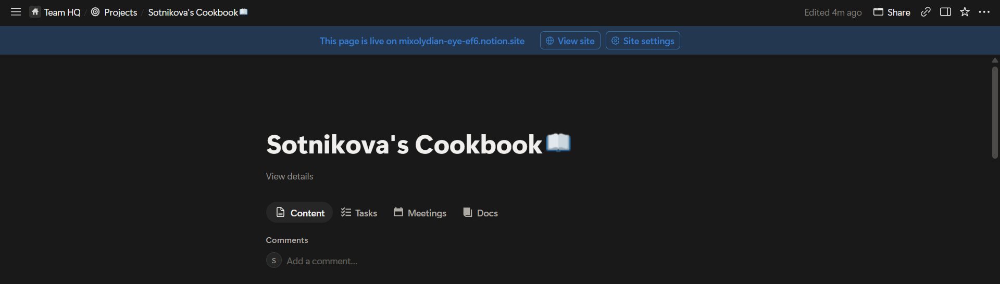
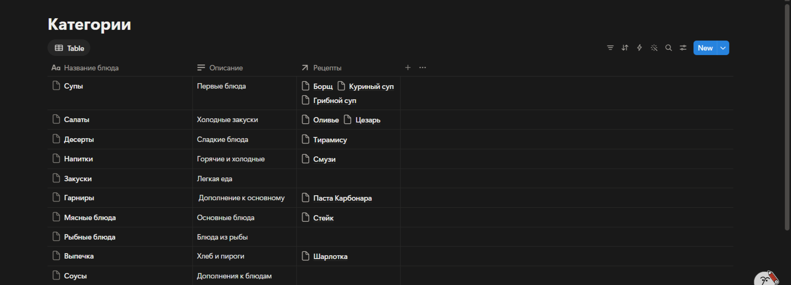
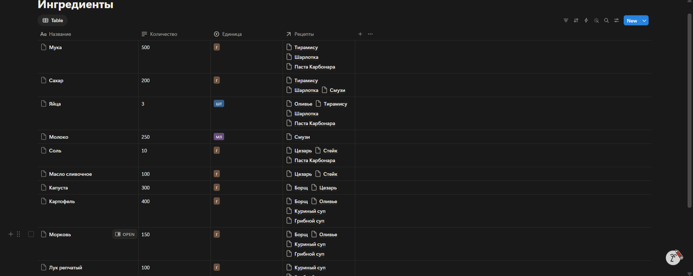
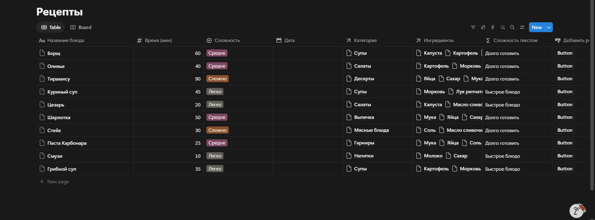
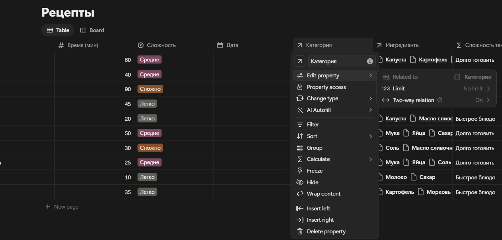
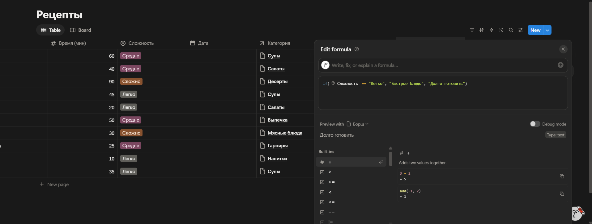
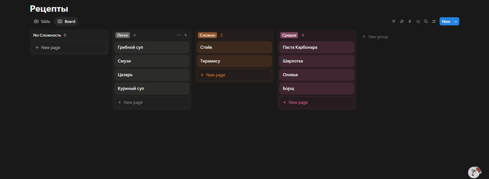

# Лабораторная работа №7. Notion

**Студент:** Сотникова Светлана  
**Группа:** ИИ-241
**Проект:** Sotnikova's Cookbook  
**Ссылка на страницу:** https://mixolydian-eye-ef6.notion.site/Sotnikova-s-Cookbook-40d6cedc736a80688f75d7c635e63fc9

## 1. Краткое описание предметной области
Создано рабочее пространство «Кулинарная книга», предназначенное для хранения рецептов, ингредиентов и их категорий. Модель данных включает 3 базы: Рецепты, Ингредиенты, Категории. Базы связаны между собой (двусторонние связи), что позволяет фильтровать данные и видеть, какие ингредиенты входят в конкретные блюда.

## 2. Промпт для ИИ и сгенерированная схема
**Промпт:** «Придумай уникальную предметную область для учебного проекта в Notion на тему "Кулинарная книга". Нужно 3 связанные сущности, минимум 2 связи Relation, свойства типов Title, Select, Date, Number, Formula. Опиши модель данных и объясни, зачем нужна каждая связь».

**Схема:**
- **Рецепты (Recipes):** Название блюда (Title), Время (Number), Сложность (Select), Дата (Date), Категория (Relation), Ингредиенты (Relation), Сложность текстом (Formula).
- **Ингредиенты (Ingredients):** Название (Title), Количество (Number), Единица измерения (Select), Рецепты (Relation).
- **Категории (Categories):** Название (Title), Описание (Text), Рецепты (Relation).

**Что исправлено:** После генерации я добавила свойство «Дата» в Рецепты для сортировки, а также включила двусторонние связи (Two-way relation), чтобы в категориях и ингредиентах было видно, к каким рецептам они относятся.

## 3. Использованные AI-промпты
1. «Придумай уникальную предметную область для проекта в Notion на тему кулинарной книги с 3 таблицами».
2. «Напиши формулу для Notion, которая выводит текст в зависимости от значения свойства Select (Сложность)».
3. «Как в Notion создать кнопку, которая добавляет новую запись в базу данных?».
4. «Как связать две базы данных в Notion с помощью Relation (двусторонняя связь)?».

## 4. Освоенные компоненты и настройки Notion
- Создание страниц и баз данных (Database).
- Настройка свойств: Title, Select, Number, Date, Formula, Button.
- Настройка связей между базами (Relation и Two-way relation).
- Создание нескольких представлений (Table и Board/Канбан).
- Публикация страницы в веб (Publish to web).
- Экспорт страницы в Markdown.

## 5. Скриншоты
**Главная страница:**

**Таблица «Категории»:**

**Таблица «Ингредиенты»:**

**Таблица «Рецепты»:**

**Настройка связей (Relation):**

**Настройка формулы:**

**Канбан-представление:**

## 6. Ограничения бесплатного тарифа Notion
На бесплатном тарифе доступно ограниченное количество загрузок файлов (до 5 МБ на файл), нет полной истории версий страницы (доступна только 7 дней), а также ограничено количество гостей (до 10). Для выполнения данной лабораторной работы этих возможностей полностью хватило.

## 7. Выводы
В ходе выполнения работы я освоила платформу Notion как инструмент для создания баз данных. Я научилась строить связи между таблицами, использовать формулы для вычислений и создавать кнопки для автоматизации действий. Notion показался очень интуитивным и удобным инструментом, который позволяет быстро создавать полезные приложения без написания кода.